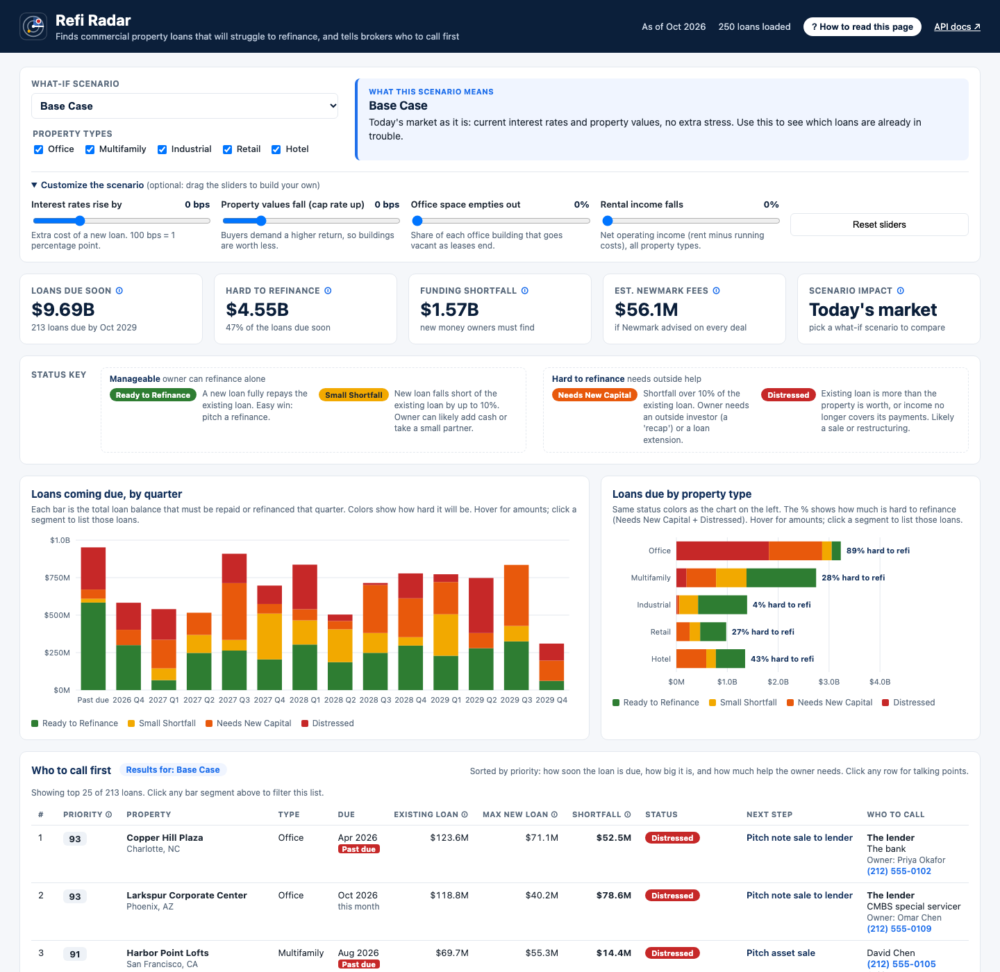
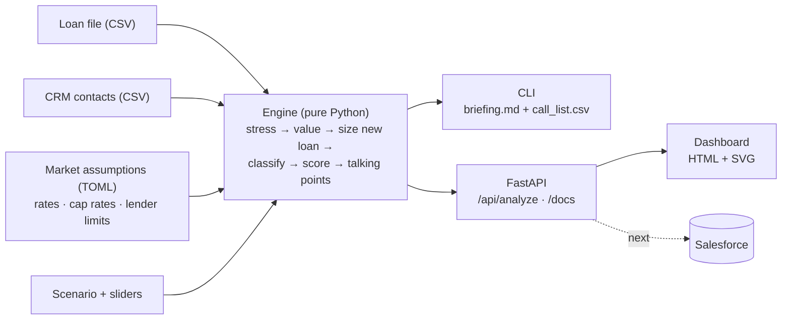

# Refi Radar

**Finds commercial real estate loans that will struggle to refinance, and tells Newmark brokers who to call
first and what to pitch.**



## Why this problem

- Roughly **$1T a year** of commercial real estate mortgages mature mid-decade (MBA, Trepp). Most of it was
  written at 3–4% rates and peak values.
- A new lender sizes the loan on **today's** income and value at ~7% rates, so it often covers far less than
  what's owed. The difference is the **shortfall** someone must fund.
- Office is hit hardest. Hybrid work keeps vacancy near record highs, and costs don't fall when tenants leave:
  a 15-point occupancy drop cuts a building's income by ~30%, not 15%. The headline stress scenario models
  exactly this.
- **Every shortfall is a Newmark transaction:** a refinance, an equity raise, a loan sale or a property sale.
  The hard part is knowing *which* loans need *what*, *when*, before competitors do.

## How I chose it

| Candidate problem | Decision |
|---|---|
| **Debt maturity wall / refinance risk** | **Chosen.** Timely, maps directly to transaction revenue, uses the same math lenders use, works with synthetic data, and is easy to test. |
| Office obsolescence (space right-sizing, office-to-residential conversion) | Compelling, but the outputs rest on softer assumptions. **Folded in as the stress scenario** instead. |
| Lease abstraction from PDFs | Valuable but crowded with vendors, and accuracy depends on an LLM I couldn't validate properly in a day or two. |

Scope rule: a narrow thing that runs beats an ambitious thing that doesn't.

## Who uses it and how Newmark makes money

**Primary user: Debt & Structured Finance brokers.** Secondary: loan sales, investment sales, valuation,
servicing, leadership.

| Status | What it means | Next step | Newmark revenue (illustrative) |
|---|---|---|---|
| Ready to Refinance | A new loan repays the existing loan | Pitch refinance | Debt placement fee (~0.5% of new loan) + servicing |
| Small Shortfall | Gap ≤ 10%; owner can cover it | Pitch refi + gap equity | ~0.5% of new loan + ~1% of equity raised for the gap |
| Needs New Capital | Gap > 10%; needs an outside investor | Pitch recapitalization | ~0.5% of new loan + ~1% of equity raised for the gap |
| Distressed, underwater | Existing loan > property value | Pitch note sale **to the lender** | Loan-sale advisory fee (~0.75% of property value) |
| Distressed, has equity | Income can't cover payments | Pitch asset sale **to the owner** | Sales commission (~1% of property value) |

## Results on the sample book (250 synthetic loans)

| Scenario | Hard to refinance | Funding shortfall | Distressed loans | Est. Newmark fees |
|---|---:|---:|---:|---:|
| Base Case | $4.55B (47%) | $1.57B | 30 | $56.1M |
| Higher for Longer (rates +0.75%) | $5.31B (55%) | $1.81B | 33 | $56.6M |
| Office Vacancy Shock (−15 pts office occupancy) | $4.90B (51%) | $2.29B | 54 | $52.2M |
| Severe Downturn (higher rates, lower values, −20 pts office occupancy) | $6.67B (69%) | $3.11B | 65 | $50.0M |

- Of the 250 loans, 213 ($9.69B) are due within 3 years, including 25 ($952M) that are **already past due**.
  The other 37 mature later and are outside the window.
- Re-underwriting the whole book takes **~5 ms**, versus an estimated ~30 analyst-minutes per loan in Excel.
  Scales to 50,000 loans in ~1 s.
- Winning 10% of the estimated fee pool would be roughly **$5.6M** from one book this size.
- Fees **shrink** under stress even as the shortfall grows, because deals shift from refinancing to
  distressed sales priced off lower values.

## Architecture



| Decision | Why | Trade-off |
|---|---|---|
| Pure-Python engine; CLI, API and dashboard are thin layers on top | Testable on its own; the dashboard calls the same API a CRM would, so numbers can't drift | Some mapping code at the edges |
| Rules and formulas, not ML | No outcome data to train on yet; brokers trust what they can trace | Score weights are judgment calls until calibrated on win/loss data |
| Market assumptions in TOML with a fixed as-of date | Research can change rates or lender limits without a deploy; reruns are reproducible | No live feeds yet |
| Row-level validation on loan files | One bad row shouldn't block 10,000 good ones | Callers must check the data-quality counts |
| Plain HTML + SVG dashboard, no front-end build | Runs offline and behind corporate proxies; nothing extra to install | Fewer chart features; production would use Newmark's standard front-end stack |
| In-memory data, recalculated per request | Simple, and fast enough at this size | Needs a database and caching at Newmark scale |

**99 pytest tests**, including known-answer mortgage math and invariants (e.g. no stress scenario may improve
any loan).

## Run it

```bash
python3.14 -m venv .venv && source .venv/bin/activate
pip install -e ".[dev]"
pytest                          # 99 tests
refi-radar serve                # dashboard http://127.0.0.1:8000  ·  API docs /docs
```

## Use it on your own loans

A broker or analyst exports a loan file (CSV) from a servicing system or a client's data. Then either:

```bash
refi-radar analyze --tape my_loans.csv --scenario office_vacancy_shock --out reports/   # briefing + call list CSV
refi-radar serve   --tape my_loans.csv --contacts my_crm_contacts.csv                  # dashboard on your data
```

Start from [`data/loan_tape_template.csv`](data/loan_tape_template.csv). Columns: `loan_id, property_name,
property_type, market, sponsor, lender_type, origination_date, maturity_date, original_balance, note_rate,
amortization_years, original_value, current_noi, occupancy`. Messy formats like `$12,500,000` and `4.5%` are
accepted, and bad rows are reported and skipped rather than failing the file. In production this would be a
nightly feed from the servicing system and CRM, not a file.

## Key assumptions

- **All data is synthetic** (fictional loans, owners and contacts) and market assumptions are illustrative.
- **Refinance is a simplified fixed-rate, 30-year loan**; no floating rates, extensions or cash-out.
- **Fee rates are placeholders** to be replaced with Newmark's actual schedules.
- **Single loan file, no login.** Fine for a demo; a real deployment needs a database and SSO.

## How I'd measure success

- Time from a loan being flagged to the first broker call
- Share of flagged loans that turn into mandates
- Fee revenue attributed to Refi Radar leads
- Accuracy of the "Distressed" flag against actual maturity defaults

## What's next

1. Live rate and cap-rate feeds instead of the TOML file.
2. Salesforce integration: read contacts, push leads with talking points, log outcomes.
3. Calibrate the priority score on real win/loss data.
4. Upload a loan file from the dashboard, with a saved history of every analysis.
5. Login and per-team access, since client loan files are confidential.
